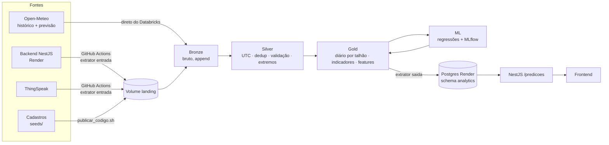

# Campo Vivo · Plataforma de dados

Pipeline de dados do **Campo Vivo** (monitoramento climático IoT para fruticultura de exportação no Vale do São Francisco):
ingestão, tratamento, análise exploratória e predição em **Databricks (Free Edition)** com **arquitetura medalhão**.



## Por que a integração é "de fora para dentro"
A Free Edition só tem compute serverless e **saída de internet restrita**. Teste em 24/11/2026:
Open-Meteo, GitHub e PyPI acessíveis; **Render e ThingSpeak bloqueados**. Por isso o GitHub Actions empurra as leituras
reais para um Volume e publica as predições no Postgres.

## ⚠️ Dados simulados
O banco de produção tinha 1 leitura. Para ter histórico suficiente para EDA e ML, a Bronze contém fontes **simuladas e
identificadas** (`_source`):

| Tabela | `_source` | Como é gerada |
|---|---|---|
| `bronze.leituras_iot` | `simulador_iot` | 36 sensores do cadastro, 1 leitura/hora desde 2019, a partir do clima **real** do Open-Meteo + microclima do talhão + ruído, com sujeira proposital (duplicados, ausentes, inválidos, extremos, 4 formatos de data) |
| `bronze.safras_historico` | `registro_produtor_simulado` | colheita quando a soma de graus-dia atinge a meta da cultura; produtividade cai com calor acima da faixa, déficit hídrico e chuva na maturação |
| `bronze.vigor_satelite` | `sentinel2_simulado` | curva de vigor por safra, observada a cada 5 dias, com falhas por nuvem |

Leituras reais do backend e do ThingSpeak entram por `bronze.leituras_iot_externo` e passam pelo mesmo tratamento.

## Estrutura
```
src/common.py               utilidades (catálogo, metadados, ruído determinístico, microclima)
src/bronze/b01…b05          cadastros · clima Open-Meteo · simulador IoT · safras e vigor · IoT externo (Auto Loader)
src/silver/s01, s02         referências tipadas · tratamento das leituras IoT (item 3)
src/gold/g01, g02           clima diário, vigor diário, indicadores (item 5) · features para ML
src/ml/m01, m02             regressões + predições (itens 6 e 7) · risco climático 7 dias
src/eda/eda_climatica.py    notebook de análise exploratória (item 4)
extrator/extrator.py        entrada (landing) · pipeline (run-now) · saida (Postgres)
jobs/…json                  definição do job no Databricks
docs/CONTRATO_PREDICOES.md  contrato das tabelas analytics e dos endpoints /predicoes
seeds/                      cadastros (fazendas, talhões, sensores, culturas…)
```

## Catálogo `campo_vivo`
- **bronze**: `cad_*`, `clima_openmeteo_horario`, `clima_previsao_diaria`, `leituras_iot`, `leituras_iot_externo`, `safras_historico`, `vigor_satelite`
- **silver**: `fazendas`, `culturas`, `talhoes`, `sensores`, `clima_horario`, `previsao_diaria`, `safras`, `vigor`, `leituras`, `leituras_horarias`, `leituras_quarentena`, `qualidade_leituras`
- **gold**: `clima_diario_talhao`, `vigor_diario`, `indicadores_talhao`, `features_safra`, `predicoes_talhao`, `predicoes_vigor_curva`, `modelo_fatores`, `modelo_metadados`, `risco_climatico_talhao`, `risco_climatico_fazenda`

## Modelos
Variáveis (X): umidade do solo · temperatura · chuva prevista (14 dias) · histórico do talhão · índice de vigor · cultura (+ estágio do ciclo).
Alvos (y): produtividade · início e duração da colheita · início e duração da exportação · curva de vigor.

`HistGradientBoostingRegressor` com perda quantílica (p05/p50/p95) e **intervalo de 90% calibrado por conformal**.
Validação temporal (teste = safras plantadas a partir de 01/06/2025). Se o ML não supera a média da cultura no teste,
o pipeline usa a média e registra isso em `gold.modelo_metadados.estrategia`. Tudo registrado no MLflow
(`/Shared/campo_vivo_predicoes`).

## Como rodar
1. Workspace Databricks com o catálogo `campo_vivo` (schemas `bronze`, `silver`, `gold`, `ml`; volumes `bronze.landing`, `bronze.code`, `gold.relatorios`).
2. `DATABRICKS_HOST=… DATABRICKS_TOKEN=… bash scripts/publicar_codigo.sh`
3. Criar o job: `POST /api/2.2/jobs/create` com `jobs/campo_vivo_pipeline_medalhao.json` (já existe: id `335240795921917`).
4. Rodar o job (UI ou `python extrator/extrator.py pipeline`).
5. EDA: no workspace, **Create → Git folder** com este repositório e abrir `src/eda/eda_climatica.py`.

### Segredos do GitHub Actions
| Nome | Tipo | Uso |
|---|---|---|
| `DATABRICKS_HOST`, `DATABRICKS_TOKEN` | secret | token **separado**, só escopos `files`, `sql`, `jobs` |
| `DATABASE_URL` | secret | URL externa do Postgres do Render |
| `DEVICE_API_KEY`, `THINGSPEAK_READ_API_KEY` | secret | opcionais |
| `DATABRICKS_WAREHOUSE_ID`, `DATABRICKS_JOB_ID`, `BACKEND_URL`, `THINGSPEAK_CHANNEL_ID` | variable | `0e8d14e2365f32b0`, `335240795921917`, `https://chico-talhao-backend.onrender.com`, `3502672` |

Agendamento: o **job do Databricks roda sozinho às 05:37 BRT** (o agendamento do GitHub Actions pode atrasar ou pular
execuções). O workflow `dados` roda a cada 3 h: envia as leituras reais e publica no Postgres as previsões mais recentes,
então uma execução pulada é recuperada na seguinte. Um push em `src/` ou `seeds/` publica o código no Volume.
Cota da Free Edition: o job completo usa ~12 min de compute serverless por dia.
